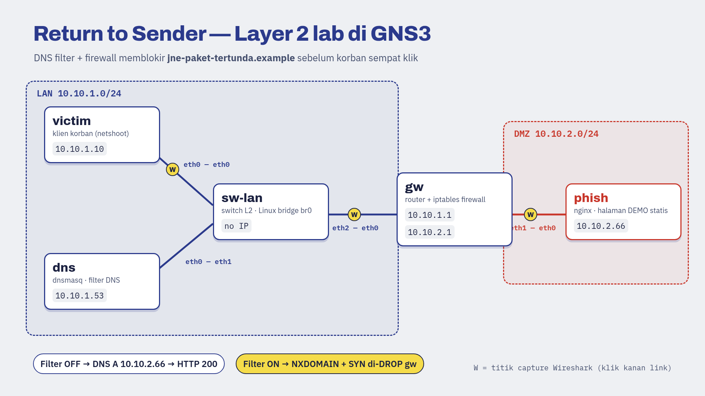

# Return to Sender: lab Layer 2 versi GNS3 (Podman)

Lab-nya sama kayak versi Containerlab (`return-to-sender/lab/containerlab`), tapi sekarang tampil di kanvas GNS3. Jadi ada gambar topologi yang bisa ditunjukin ke dosen, dan capture Wireshark tinggal klik kanan di link.



| Node | Image | Interface | IP / fungsi |
|---|---|---|---|
| victim | `localhost/rts-victim` (netshoot) | eth0 | 10.10.1.10, gateway .1, DNS .53 |
| dns | `localhost/rts-dns` (alpine + dnsmasq) | eth0 | 10.10.1.53, filter DNS |
| sw-lan | `localhost/rts-sw` (alpine) | eth0–eth3 | switch L2 (Linux bridge `br0`), tanpa IP |
| gw | `localhost/rts-gw` (netshoot) | eth0 / eth1 | 10.10.1.1 (LAN) / 10.10.2.1 (DMZ), iptables |
| phish | `localhost/rts-phish` (nginx) | eth0 | 10.10.2.66, halaman DEMO statis (tanpa form) |

Kabelnya: victim eth0 → sw-lan eth0, dns eth0 → sw-lan eth1, gw eth0 → sw-lan eth2, gw eth1 → phish eth0.

**Kenapa switch-nya container?** Ethernet switch bawaan GNS3 butuh Dynamips, dan Dynamips nggak ada di Fedora. Makanya switch-nya dibikin dari container kecil yang isinya Linux bridge. Fungsinya sama, ikonnya juga tetap ikon switch.

**Kenapa IP-nya udah ke-set sendiri?** Semua konfigurasi (IP, dnsmasq, iptables, nginx) udah dimasukin ke image. Waktu node di-start, GNS3 jalanin `/gns3/init.sh`-nya dulu, yang nunggu interface `ethX` dipasang uBridge. Abis itu baru `/lab/start.sh` dari image yang jalan. Jadi kamu nggak perlu ngisi "Edit network configuration".

---

## Peringatan dulu: GNS3 + Podman itu belum didukung resmi

GNS3 2.2 cuma bisa ngobrol sama **Docker API** di `/var/run/docker.sock`. Podman rootful punya API yang kompatibel, tapi ada dua beda (dicek dari source code GNS3):

1. **Podman ngabaikan `NetworkDisabled`.** Akibatnya container dapat `eth0` sendiri, terus uBridge GNS3 gagal mindahin `eth0` karena namanya bentrok (lihat [GNS3/gns3-server#1811](https://github.com/GNS3/gns3-server/issues/1811)). Solusinya: podman **root** di-set `netns = "none"` sama `no_hosts = true`, dan itu udah dikerjain sama script setup.
2. **Podman nggak punya endpoint `attach/ws`.** Itu yang dipakai console telnet GNS3, jadi semua node di project ini sengaja di-set **console type = none**. Buat masuk shell node pakai `./scripts/shell.sh <node>`, bukan double-click.

Disiapkan untuk Fedora 44 dengan Podman 6.1.3, podman-docker, busybox static, dan ubridge yang sudah punya caps. **Sudah diverifikasi end-to-end pada 23 November 2026, sekitar 14:56 WIB**, di laptop Fedora dengan GNS3 2.2.61 dan Podman 6.1.3 lewat `docker.sock`. Hasil `./scripts/demo.sh` sama dengan lab Containerlab (filter OFF: `200 OK`; filter ON: NXDOMAIN plus DROP). Screenshot topologi yang sedang jalan: [`topology-running.png`](topology-running.png).

---

## 0. Matiin lab Containerlab dulu (kalau masih nyala)

```fish
cd return-to-sender/lab/containerlab
sudo containerlab destroy --runtime podman -t rts-lab.clab.yml --cleanup
```

## 1. Setup sekali: Podman ↔ GNS3 (butuh sudo)

```fish
cd return-to-sender/lab/gns3
sudo ./host/setup-podman-for-gns3.sh
```

Yang dikerjain script itu (bisa juga diketik manual):

- Cek `busybox`. GNS3 nyuntikin busybox **static** ke tiap container.
- Bikin grup `docker` terus masukin user kamu ke situ. Ingat, anggota grup ini setara root. Buat laptop pribadi masih oke.
- Drop-in `/etc/systemd/system/podman.socket.d/10-rts-gns3.conf` (`SocketGroup=docker`, `SocketMode=0660`, terus `chmod 0755 /run/podman`). Folder itu aslinya `0700`, makanya user kamu nggak bisa nembus ke socket-nya.
- Symlink `/run/docker.sock → /run/podman/podman.sock` udah ada dari paket `podman-docker`. Script cuma bikin sendiri kalau ternyata belum ada.
- `/etc/containers/containers.rootful.conf.d/50-rts-gns3.conf` berisi `netns = "none"` dan `no_hosts = true`. Ini drop-in resmi Podman 6 yang cuma berlaku buat podman root, jadi Podman rootless nggak kena.
- Restart `podman.socket`.
- `setcap cap_net_admin,cap_net_raw=ep /usr/bin/ubridge` kalau belum ada. Kalau sudah ada, bagian ini di-skip.

Abis itu **logout terus login lagi** (atau reboot) biar grup `docker` aktif.

Buat bongkar semuanya: `sudo ./host/setup-podman-for-gns3.sh --undo`.
Buat matiin atau nyalain mode `netns=none` aja: `sudo ./host/gns3-mode.sh off` / `on` / `status`.

## 2. Build image (butuh sudo, image masuk storage podman root)

```fish
cd return-to-sender/lab/gns3
./build-images.sh
```

Kalau download error dan WARP lagi nyala, pause WARP dulu terus ulang. Build-nya pakai `--network host`, jadi tetap jalan walaupun mode GNS3 lagi ON.

## 3. Cek semuanya (tanpa sudo)

```fish
./host/check-setup.sh
```

Semua baris harus `[OK]`. Yang paling penting yang ini: **"container test cuma punya: lo"**. Itu bukti podman nggak lagi nambahin `eth0` sendiri.

## 4. Buka project di GNS3

1. Tutup GNS3 kalau lagi kebuka, terus buka lagi. Server lokalnya perlu restart biar kebaca grup `docker` yang baru.
2. Pilih salah satu:
   - **File → Import portable project…** → pilih `return-to-sender/lab/gns3/project/rts-gns3.gns3project` → kasih nama `rts-gns3` → OK. (Disarankan, project-nya jadi disalin ke `~/GNS3/projects/`.)
   - **File → Open project…** → *Open a project from disk* → pilih `return-to-sender/lab/gns3/project/rts-gns3.gns3`.
3. Nanti di kanvas muncul 5 node yang udah tersambung, plus kotak LAN/DMZ dan label IP-nya.

Pas project dibuka, GNS3 langsung bikin container-nya (status masih stopped). Kalau muncul error *image not found*, berarti image-nya belum ada di podman **root**. Ulangi langkah 2.

## 5. Start dan demo

1. Klik **▶ Start all** di toolbar. Kelima node bakal jadi hijau.
2. Di terminal:

```fish
cd return-to-sender/lab/gns3
./scripts/status.sh      # cek IP + status filter
./scripts/demo.sh        # filter OFF → halaman DEMO kebuka; filter ON → NXDOMAIN + DROP
```

Ganti mode filter secara manual:

```fish
./scripts/filter-on.sh
./scripts/filter-off.sh
```

Masuk shell node (pengganti console):

```fish
./scripts/shell.sh victim
# di dalam victim:
dig jne-paket-tertunda.example
curl -v http://jne-paket-tertunda.example/
```

## 6. Capture Wireshark (klik kanan link)

1. Klik kanan link **victim ↔ sw-lan** → **Start capture** → OK. Wireshark bakal kebuka sendiri.
2. Biar lengkap, lakuin hal yang sama di link **gw ↔ phish** (sisi DMZ). Link **sw-lan ↔ gw** juga bisa.
3. Jalanin `./scripts/demo.sh`.
4. Filter tampilan: `dns || http || tcp.flags.syn==1`
   - OFF: `A 10.10.2.66`, terus `GET /` → `HTTP/1.1 200 OK`
   - ON: `No such name` (NXDOMAIN), terus SYN ke 10.10.2.66 retransmit terus. Di link gw↔phish **nggak ada paket sama sekali**, dan itu bukti firewall nge-DROP.
5. Simpan: File → Save As → `return-to-sender/lab/gns3/captures/gns3-demo.pcapng`. Klik kanan link → Stop capture.

Kalau Wireshark nggak kebuka, cek Edit → Preferences → Packet capture. Command default Linux-nya:
`tail -f -c +0b %c | wireshark -o "gui.window_title:%d" -k -i -`.
Cara cadangan tanpa capture GNS3: `./scripts/capture-fallback.sh gw eth0` (atau `gw eth1`).

Screenshot kanvas GNS3 pas semua node hijau dan link-nya lagi di-capture (ada ikon kaca pembesar), itu yang buat slide. Gambar siap-pakai juga ada di `diagram/topology.png`.

## 7. Selesai

Klik **■ Stop all** di GNS3, terus tutup project. Container-nya dihapus GNS3 waktu project ditutup atau dihapus.

---

## (Opsional) Bikin template biar bisa drag node sendiri

Project-nya udah lengkap, jadi bagian ini cuma perlu kalau mau nambah node baru.
Edit → Preferences → Docker → **Docker containers** → **New**:

1. *Run this Docker container on my local computer* → Next.
2. *Existing image* → pilih `localhost/rts-victim:latest` → Next.
3. Nama `rts-victim` → Next.
4. Adapters: victim/dns/phish `1`, gw `2`, sw `4` → Next.
5. Start command: **kosongin** → Next.
6. Console type: **none** → Next. (Telnet nggak jalan di Podman.)
7. Environment: kosongin → Finish. Abis itu klik **Edit** → Symbol (`computer`, `server`, `ethernet_switch`, `firewall`).

Ulangi buat `rts-dns`, `rts-sw`, `rts-gw`, `rts-phish`. Template-nya nanti muncul di sidebar *End devices* / *All devices*.

## (Opsional) VPCS

Lab ini nggak butuh VPCS. Tapi kalau mau PC mini bawaan GNS3:

```fish
sudo dnf install gcc make git
./vpcs/build-vpcs.sh
```

Abis itu Edit → Preferences → VPCS → path absolut ke `~/.local/bin/vpcs` (misalnya `/home/<user>/.local/bin/vpcs`). Kalau mau disambung ke lab, tambahin 1 VPCS ke `sw-lan eth3` (port cadangan) dengan IP `ip 10.10.1.20/24 10.10.1.1`.

## (Opsional) Auxiliary console GNS3

Console aux GNS3 jalan pakai `docker exec`. Kalau mau dicoba: `sudo dnf install podman-docker`, tutup GNS3, terus buka lewat `./gns3-podman.sh`. Script itu nge-set `CONTAINER_HOST` biar `docker exec` nyambung ke podman root. Habis itu klik kanan node → *Auxiliary console*. Ini belum dites, jadi kalau gagal pakai `./scripts/shell.sh` aja.

---

## Troubleshooting

| Gejala | Penyebab / solusi |
|---|---|
| `Can't connect to Docker daemon` | Socket belum bisa diakses, atau GNS3 dibuka tanpa keanggotaan grup `docker`. Jalanin `./host/check-setup.sh`. Kalau check-nya sudah `[OK]` tapi GNS3 tetap error, sesi desktop-nya masih yang lama (sebelum masuk grup). Logout/login grafis, atau dari terminal: `pkill -f gns3; sg docker -c gns3`. Cek `ls -lL /var/run/docker.sock`, grup-nya harus `docker`. |
| `No busybox executable could be found` / *dynamically linked* | `sudo dnf install busybox`, cek `ldd (which busybox)` harus *not a dynamic executable*. Kalau ternyata dynamic, cari build busybox static. |
| Node gagal start, error soal namespace / `eth0` / `File exists` | Mode `netns=none` belum aktif: `sudo ./host/gns3-mode.sh on`, terus Stop/Start node. Cek lagi pakai `check-setup.sh`. |
| `uBridge requires root access or the capability...` | `sudo setcap cap_net_admin,cap_net_raw=ep /usr/bin/ubridge` |
| Double-click node nggak kebuka apa-apa | Emang gitu: console = none. Pakai `./scripts/shell.sh <node>`. |
| Error console / websocket waktu start | Ada node yang console type-nya bukan none. Klik kanan → Configure → Console type: none. |
| `node 'xxx' belum jalan` dari script | Klik ▶ Start all dulu. Nama container-nya `GNS3.<node>.<project-id>`, bisa dicek pakai `sudo podman ps`. |
| curl gagal walaupun filter OFF | `./scripts/status.sh`. Kalau IP kosong, Stop/Start node-nya. `./scripts/shell.sh sw-lan bridge link` harus nampilin eth0–eth3. |
| `Permission denied` ke `/gns3/init.sh` (SELinux) | Harusnya nggak kejadian karena node privileged = label SELinux dimatiin. Kalau tetap kejadian, cek `sudo ausearch -m avc -ts recent` untuk lihat penyebabnya. |
| Containerlab jadi aneh setelah setup ini | `sudo ./host/gns3-mode.sh off` waktu pakai Containerlab, terus `on` lagi waktu pakai GNS3. |
| Pull/build gagal | Pause Cloudflare WARP, ulangi `./build-images.sh`. |

## Isi folder

```
README.md                 panduan ini
build-images.sh           build 5 image (sudo podman)
gns3-podman.sh            opsional: launcher GNS3 buat aux console
host/setup-podman-for-gns3.sh   setup sudo sekali (socket, grup, netns=none, ubridge caps)
host/gns3-mode.sh         nyalain/matiin netns=none buat podman root
host/check-setup.sh       cek prasyarat tanpa sudo
images/<node>/            Containerfile + start.sh tiap node
project/rts-gns3.gns3     project GNS3 2.2 (5 node + 4 link + label)
project/rts-gns3.gns3project   versi portable (zip) buat Import
scripts/                  demo.sh, filter-on/off.sh, status.sh, shell.sh, capture-fallback.sh
diagram/topology.png      gambar topologi buat slide (1920×1080)
vpcs/build-vpcs.sh        opsional: compile VPCS
tools/gen_project.py      generator file .gns3 (kalau mau ubah posisi/IP label)
captures/                 tempat simpan pcapng
```
