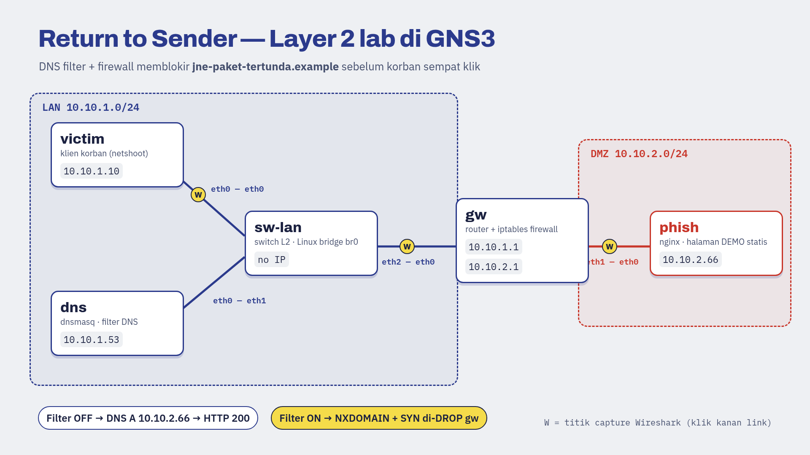

# L2 lab, GNS3 version (Docker nodes on Podman)

The same lab as [`../containerlab`](../containerlab), drawn on a GNS3 canvas so the topology is visible and any link can be captured with a right-click.



| Node | Image | IP / role |
| --- | --- | --- |
| victim | `localhost/rts-victim` (netshoot) | 10.10.1.10, gateway .1, DNS .53 |
| dns | `localhost/rts-dns` (alpine + dnsmasq) | 10.10.1.53, DNS filter |
| sw-lan | `localhost/rts-sw` (alpine) | L2 switch (Linux bridge), no IP |
| gw | `localhost/rts-gw` (netshoot) | 10.10.1.1 (LAN) / 10.10.2.1 (DMZ), iptables |
| phish | `localhost/rts-phish` (nginx) | 10.10.2.66, static DEMO page (no form) |

`sw-lan` is a small container instead of the built-in GNS3 Ethernet switch, because that switch needs Dynamips, which Fedora does not package. All IP, dnsmasq, iptables and nginx settings are baked into the images, so nothing has to be typed into "Edit network configuration".

## Status

GNS3 2.2 expects the Docker API. This project uses rootful Podman's Docker-compatible socket with two workarounds:

1. Rootful Podman is set to `netns = "none"` and `no_hosts = true`, so GNS3/uBridge can attach the interfaces itself (see [GNS3/gns3-server#1811](https://github.com/GNS3/gns3-server/issues/1811)). This applies to **all** rootful containers; turn it off with `sudo ./host/gns3-mode.sh off`.
2. Podman has no `attach/ws` endpoint, so the GNS3 telnet console does not work. Every node uses console type *none*; open a shell with `./scripts/shell.sh <node>`.

The project loads in GNS3 2.2.61. It has **not yet been verified end-to-end on Podman**.

## Run

```bash
cd lab/gns3
sudo ./host/setup-podman-for-gns3.sh   # adds a docker group + socket permissions; log out and in afterwards
./build-images.sh
./host/check-setup.sh
```

1. Open GNS3 → **File → Import portable project** → `project/rts-gns3.gns3project`.
2. Press ▶ to start all nodes.
3. Run `./scripts/demo.sh` (filter OFF vs ON). Use `./scripts/filter-on.sh` / `./scripts/filter-off.sh` to switch.
4. Right-click the victim↔sw-lan or gw↔phish link → **Start capture** to open Wireshark.

Undo the host changes with `sudo ./host/setup-podman-for-gns3.sh --undo`. Members of the `docker` group are effectively root, so only do this on a personal or lab machine.

Optional: `vpcs/build-vpcs.sh` compiles VPCS from source if you want GNS3's mini PCs. The full guide (in Bahasa Indonesia) is [`GUIDE.id.md`](GUIDE.id.md).
